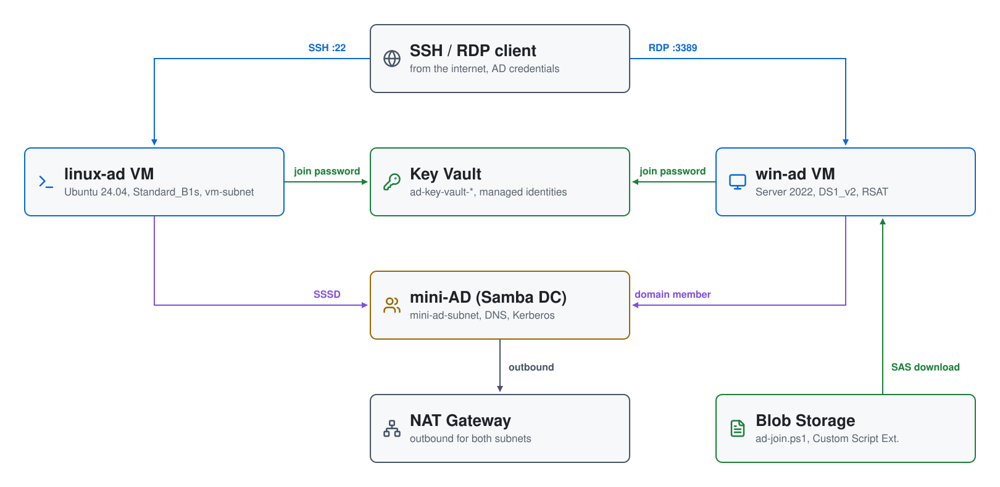
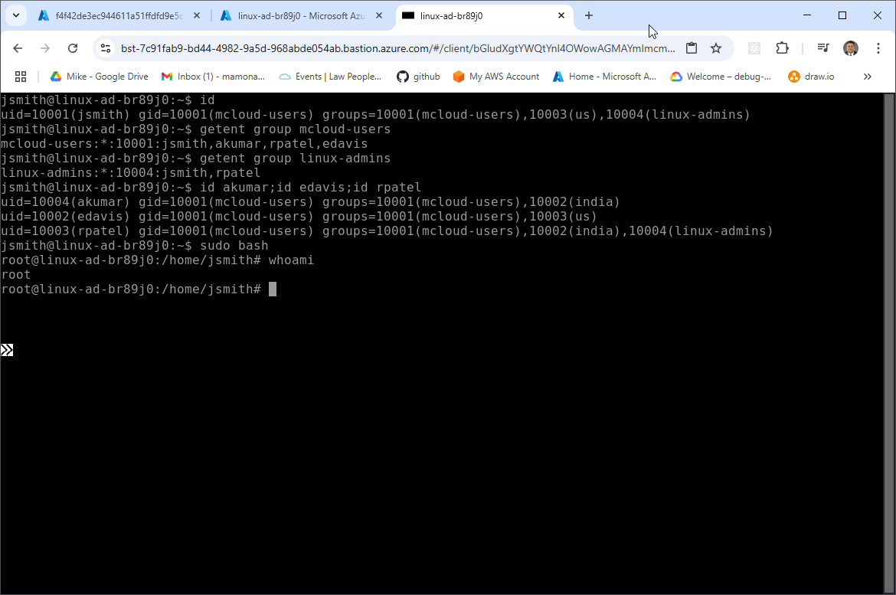

# Mini Active Directory on Azure

A small, fast, low-cost **Active Directory** domain for labs: a **Samba 4**
domain controller on one Azure VM, built much more quickly than Microsoft
Entra Domain Services, with a Linux and a Windows VM that join the domain at
boot. It's the follow-up to our Entra Domain Services project, and the base
that the other Azure mini-AD projects build on. Not for production.

| Piece | Where | Role |
|---|---|---|
| **mini-AD** (Samba DC) | `mini-ad-subnet` (10.0.0.128/25) | domain `mcloud.mikecloud.com` / `MCLOUD`: users, groups, POSIX IDs, DNS, Kerberos; built by [`module-azure-mini-ad`](https://github.com/mamonaco1973/module-azure-mini-ad) |
| **linux-ad VM** | `vm-subnet` (10.0.0.0/25) | Ubuntu 24.04, `Standard_B1s`; joins with `realm` and SSSD; SSH with AD passwords |
| **win-ad VM** | `vm-subnet` | Windows Server 2022 Datacenter, `Standard_DS1_v2`; joins the domain; RSAT for managing users |
| **Key Vault** | `mcloud-project-rg` | `ad-key-vault-<suffix>`: AD admin, user and VM passwords; read by the VMs' managed identities |
| **Blob Storage** | `mcloud-project-rg` | serves the Windows join script to the Custom Script Extension |
| **NAT gateway** | both subnets | outbound internet for the VNet |

## Architecture

<picture>
  <source media="(prefers-color-scheme: dark)" srcset="architecture-dark.svg">
  
</picture>

Regenerate with `python3 make_diagram.py`.

- **`01-directory/`**: the resource group (`mcloud-project-rg`), the VNet
  (`ad-vnet`, 10.0.0.0/23) with `vm-subnet` and `mini-ad-subnet`, the NAT
  gateway, `vm-nsg`, the Key Vault and AD passwords, and the DC, with users
  and POSIX attributes from `scripts/users.json.template`. Azure Bastion is
  optional (`bastion_support`, off by default).
- **`02-servers/`**: the Linux and Windows VMs with their managed identities
  and Key Vault access, and the Blob Storage account for the Windows join
  script.

## How the members join

1. **Linux**: installs SSSD, realmd and the Azure CLI, signs in with its
   managed identity, reads `admin-ad-credentials` from Key Vault, and joins
   with `realm join`. SSSD is set for short names and the POSIX IDs stored in
   AD; home directories are created on first login; `linux-admins` get
   passwordless sudo.
2. **Windows**: the Custom Script Extension downloads `ad-join.ps1` from Blob
   Storage with a read-only SAS. The script installs RSAT and the Azure CLI,
   reads the same secret with the VM's managed identity, joins with
   `Add-Computer`, adds `MCLOUD\mcloud-users` to Remote Desktop Users, and
   reboots. Its log is `C:\WindowsAzure\Logs\ad-join.log`.

| User | Groups | sudo on Linux |
|---|---|---|
| jsmith | mcloud-users, us, linux-admins, Domain Admins | yes |
| edavis | mcloud-users, us | no |
| rpatel | mcloud-users, india, linux-admins, Domain Admins | yes |
| akumar | mcloud-users, india | no |

| Group | gidNumber |
|---|---|
| mcloud-users | 10001 |
| us | 10002 |
| india | 10003 |
| linux-admins | 10004 |

## What mini-AD doesn't do

Compared with Microsoft Entra Domain Services, a single Samba DC on a VM
gives up:

- **Operations**: no replica set or zone redundancy, no automatic backups or
  patching, no Microsoft-managed hardening, support, or Azure Monitor
  integration.
- **Features**: no built-in sync from Entra ID; limited GPO support without
  replication; no AD Web Services, so many AD PowerShell cmdlets don't work;
  trusts with an on-premises AD need manual setup.

## Network security

```
internet ─22, 3389─▶ vm-subnet (linux-ad VM, win-ad VM)
```

`vm-nsg` on `vm-subnet` allows 22 and 3389 from anywhere; every login still
needs an AD account. The DC has no public address.

## Prerequisites

* [An Azure Account](https://portal.azure.com/)
* [Install AZ CLI](https://learn.microsoft.com/en-us/cli/azure/install-azure-cli)
* [Install Terraform](https://developer.hashicorp.com/terraform/install)
* [Install jq](https://jqlang.github.io/jq/download/)

`check_env.sh` expects a service principal in `ARM_CLIENT_ID`,
`ARM_CLIENT_SECRET`, `ARM_SUBSCRIPTION_ID` and `ARM_TENANT_ID`. If this is
your first time watching our content, we recommend starting with this video:
[Azure + Terraform: Easy Setup](https://www.youtube.com/watch?v=wwi3kVgYNOk).

## Deploy

```bash
git clone https://github.com/mamonaco1973/azure-mini-ad.git
cd azure-mini-ad
./apply.sh       # 1: VNet + mini-AD + Key Vault  2: Linux and Windows VMs
```

Everything deploys to Central US. After `apply.sh` finishes, the Linux VM
needs a few minutes to join the domain, and the Windows VM longer, because
it joins and then reboots. `apply.sh` ends by running `validate.sh`:

```
============================================================================
Mini-AD Quick Start - Validation Output (Azure)
============================================================================

NOTE: Resource Group:        mcloud-project-rg
NOTE: Key Vault:             ad-key-vault-a1b2c3d4
NOTE: Windows RDP Host:      win-ad-a1b2c3.centralus.cloudapp.azure.com
NOTE: Linux SSH Host:        linux-ad-a1b2c3.centralus.cloudapp.azure.com
```

## Try it

1. Get a user's password:

   ```bash
   vault=$(az keyvault list -g mcloud-project-rg --query "[?starts_with(name, 'ad-key-vault')].name | [0]" -o tsv)
   az keyvault secret show --vault-name "$vault" --name jsmith-ad-credentials \
     --query value -o tsv | jq -r .password
   ```

2. RDP to the **Windows RDP Host** as `MCLOUD\jsmith`. **Active Directory
   Users and Computers** is installed.

   

3. SSH to the **Linux SSH Host** as `jsmith`. Try `id`,
   `getent group linux-admins` and `sudo -l`.

   

## Troubleshooting

| Symptom | Fix |
|---|---|
| SSH rejects every AD password | The Linux VM hasn't finished joining. Check `/var/log/cloud-init-output.log` on it. |
| RDP rejects `MCLOUD\jsmith` | The Windows VM joins and then reboots; give it several minutes, then read `C:\WindowsAzure\Logs\ad-join.log`. |
| `id <user>` finds nothing | The user needs `uidNumber`, `gidNumber` and `uid` set in AD. SSSD caches lookups; `sudo sss_cache -E` clears it. |

## Teardown

```bash
./destroy.sh     # destroys the VMs, then the DC, VNet and Key Vault (purged)
```

## Notes

- **Lab only.** SSH and RDP are open to the internet, jsmith and rpatel are
  Domain Admins, and the join uses the domain admin account. Restrict
  `vm-nsg` and use a dedicated join account for anything more.
